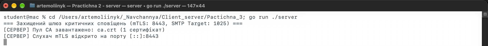
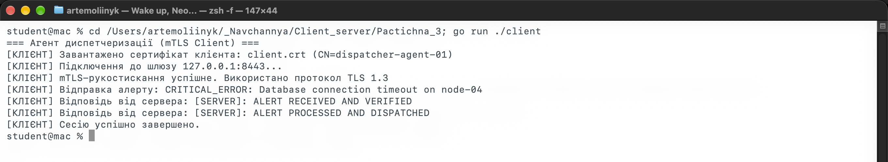
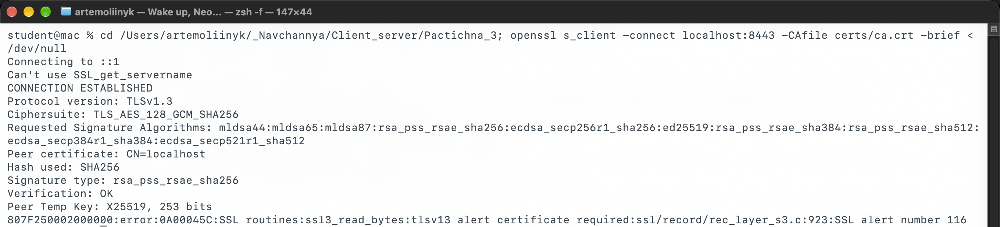
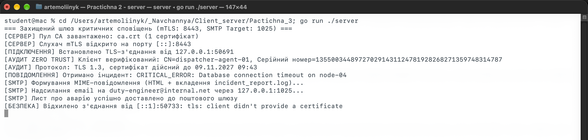
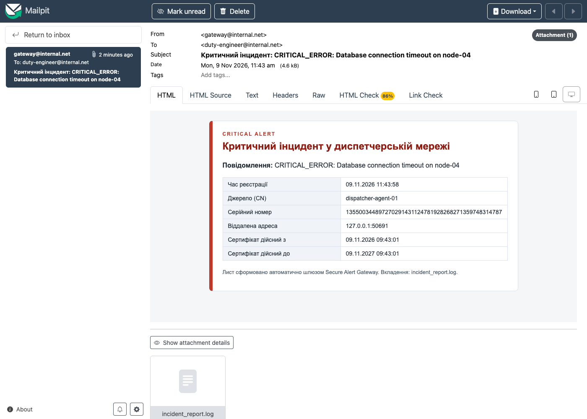
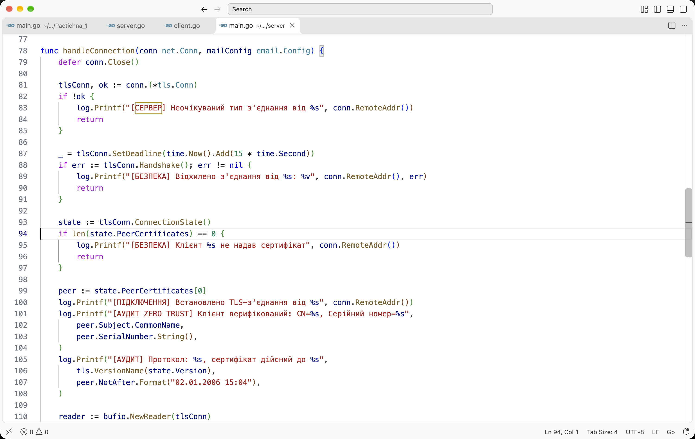
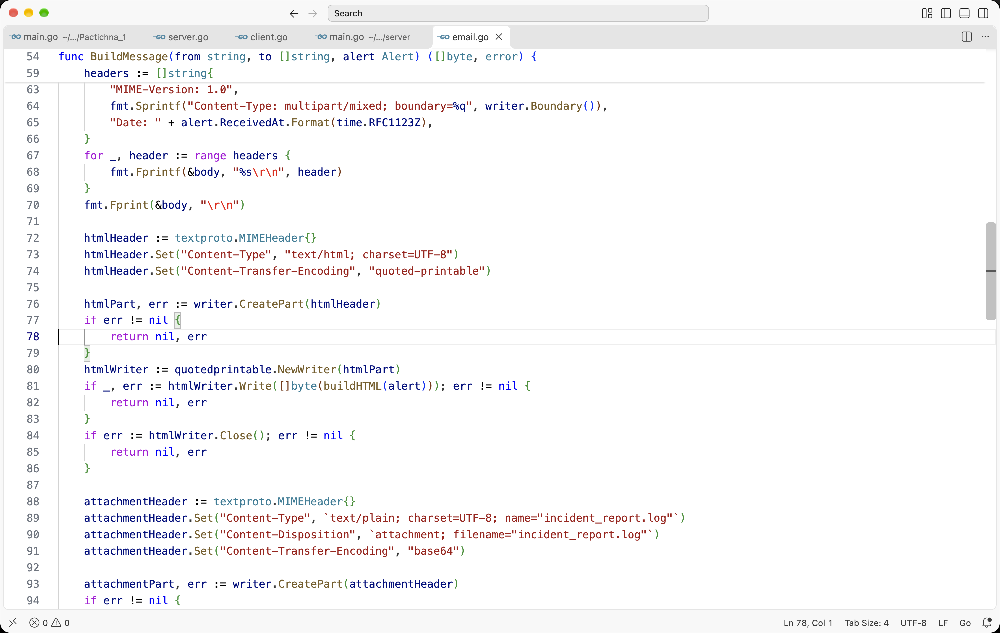
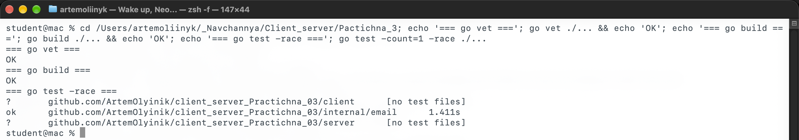

# Практична робота № 3. Налаштування захищеного каналу mTLS та протокол SMTP

**Виконав:** Олійник Артем Сергійович  
**Курс:** IV  
**Група:** КН-43  
**Дисципліна:** Розробка застосувань клієнт-серверної архітектури  
**Викладач:** Олександр Олександрович Верещагін  
**Рік:** 2026

---

## Мета роботи

- Опанувати принципи PKI та генерації сертифікатів X.509.
- Налаштувати mTLS із двосторонньою автентифікацією у `crypto/tls`.
- Опанувати надсилання пошти через `net/smtp` і локальний SMTP-емулятор.
- Сформувати MIME-лист з HTML-тілом і вкладенням Base64.

---

## Середовище

| Компонент | Версія |
|---|---|
| Операційна система | macOS 27.0.1 |
| Go | 1.27.1 |
| OpenSSL | 4.0.3 |
| SMTP-емулятор | Mailpit (Docker, `axllent/mailpit`) |
| Visual Studio Code | 1.145.2 |

Модуль проєкту: `github.com/ArtemOlyinik/client_server_Practichna_03`.

---

## Хід виконання

### Рівень 1. Генерація PKI та захищений mTLS-шлюз

#### 1. Ініціалізація проєкту

Створюємо модуль, пакети `server`, `client`, `internal/email` і теку `certs`:

```bash
go mod init github.com/ArtemOlyinik/client_server_Practichna_03
```

Структура проєкту:

```text
client_server_Practichna_03/
├── certs/                     # згенеровані сертифікати (не комітяться)
├── client/main.go             # mTLS-клієнт
├── docs/                      # текст завдання
├── internal/email/            # SMTP і MIME
├── screenshots/               # скріншоти роботи
├── server/main.go             # mTLS-сервер та аудит
├── generate_certs.sh          # генерація PKI
└── README.md
```

#### 2. Генерація інфраструктури сертифікатів

Скрипт `generate_certs.sh` створює Root CA, серверний і клієнтський сертифікати. Для сервера додано SAN `localhost` та `127.0.0.1`, для клієнта - `CN=dispatcher-agent-01`.

```bash
./generate_certs.sh
```

Основні команди:

```bash
openssl req -x509 -newkey rsa:2048 -nodes \
    -keyout ca.key -out ca.crt -days 365 -subj "/CN=MyRootCA"

openssl req -newkey rsa:2048 -nodes \
    -keyout server.key -out server.csr -subj "/CN=localhost"

openssl x509 -req -in server.csr \
    -CA ca.crt -CAkey ca.key -CAcreateserial \
    -out server.crt -days 365 \
    -extfile <(printf "subjectAltName=DNS:localhost,IP:127.0.0.1\nextendedKeyUsage=serverAuth\n")

openssl req -newkey rsa:2048 -nodes \
    -keyout client.key -out client.csr -subj "/CN=dispatcher-agent-01"

openssl x509 -req -in client.csr \
    -CA ca.crt -CAkey ca.key -CAcreateserial \
    -out client.crt -days 365 \
    -extfile <(printf "extendedKeyUsage=clientAuth\n")
```

Після генерації в теці `certs` з'являються `ca.crt`, `ca.key`, `server.crt`, `server.key`, `client.crt`, `client.key`. Закриті ключі мають права `600` і не публікуються в репозиторії.

#### 3. Реалізація mTLS-сервера

Сервер слухає порт `:8443` через `tls.Listen`. У конфігурації завантажено серверний сертифікат, Root CA у `ClientCAs` і встановлено політику `tls.RequireAndVerifyClientCert`:

```go
tlsConfig := &tls.Config{
    Certificates: []tls.Certificate{serverCert},
    ClientAuth:   tls.RequireAndVerifyClientCert,
    ClientCAs:    caPool,
    MinVersion:   tls.VersionTLS13,
}
listener, err := tls.Listen("tcp", ":8443", tlsConfig)
```

Під час підключення сервер явно викликає `Handshake()`. Якщо клієнтський сертифікат відсутній або не підписаний довіреним CA, з'єднання відхиляється.



*Рис. 1. Сервер завантажив CA і відкрив mTLS-слухач на порту 8443.*

#### 4. Авторизований mTLS-клієнт

Клієнт завантажує `client.crt`, `client.key` і `ca.crt`, підключається через `tls.Dial` та надсилає повідомлення про інцидент:

```go
tlsConfig := &tls.Config{
    Certificates: []tls.Certificate{clientCert},
    RootCAs:      caPool,
    ServerName:   "localhost",
    MinVersion:   tls.VersionTLS13,
}
conn, err := tls.Dial("tcp", "127.0.0.1:8443", tlsConfig)
```

Після рукостискання клієнт відправляє `CRITICAL_ERROR: Database connection timeout on node-04` і читає дві відповіді сервера.



*Рис. 2. Клієнт із сертифікатом `CN=dispatcher-agent-01` пройшов mTLS, отримав підтвердження прийому та обробки.*

#### 5. Перевірка відхилення неавторизованого доступу

Підключаємося без клієнтського сертифіката:

```bash
openssl s_client -connect localhost:8443 -CAfile certs/ca.crt -brief < /dev/null
```

Клієнт отримує помилку `SSL alert certificate required`, а сервер фіксує `tls: client didn't provide a certificate` і закриває з'єднання.



*Рис. 3. Спроба підключення без клієнтського сертифіката: TLS-рукостискання завершується помилкою.*



*Рис. 4. Консоль сервера: успішний аудит клієнта, відправка листа та відмова клієнту без сертифіката.*

---

### Рівень 2. Автоматична відправка email-сповіщень через SMTP

#### 1. Підготовка SMTP-емулятора

Запускаємо Mailpit у Docker:

```bash
docker run -d --name mailpit-p3 \
    -p 1025:1025 -p 8025:8025 \
    axllent/mailpit
```

Порт `1025` приймає SMTP-повідомлення, порт `8025` відкриває вебінтерфейс для перегляду листів.

#### 2. Модуль відправки пошти

Пакет `internal/email` містить функцію `Send`, яка формує лист і передає його `smtp.SendMail`. Параметри задаються через змінні середовища або типові значення:

| Параметр | Типове значення |
|---|---|
| `SMTP_ADDR` | `127.0.0.1:1025` |
| `MAIL_FROM` | `gateway@internal.net` |
| `MAIL_TO` | `duty-engineer@internal.net` |

Заголовки `From`, `To`, `Subject` і `Date` формуються явно. Тема кодується у UTF-8 через `mime.QEncoding`, щоб український текст коректно відображався в поштових клієнтах.

#### 3. Інтеграція з сервером

Після успішного прийому mTLS-повідомлення сервер збирає `email.Alert` з текстом інциденту, часом, CN клієнта, серійним номером і строком дії сертифіката. Далі викликається `email.Send`, а в консоль виводяться етапи формування та відправки.

#### 4. Перевірка доставки

У консолі сервера бачимо `[SMTP] Лист про аварію успішно доставлено до поштового шлюзу` (рис. 4). У вебінтерфейсі Mailpit лист має тему `Критичний інцидент: CRITICAL_ERROR: Database connection timeout on node-04`, HTML-таблицю з даними клієнта та вкладення `incident_report.log`.



*Рис. 5. Mailpit: HTML-лист із таблицею аудиту та вкладенням `incident_report.log`.*

---

### Рівень 3. Аудит Zero Trust, MIME-форматування та вкладення

#### 1. Аудит суб'єкта сертифіката

Після `Handshake()` сервер отримує `ConnectionState()` і перший сертифікат із `PeerCertificates`. З нього читаються `Subject.CommonName`, `SerialNumber`, `NotBefore` і `NotAfter`:

```go
state := tlsConn.ConnectionState()
peer := state.PeerCertificates[0]
log.Printf("[АУДИТ ZERO TRUST] Клієнт верифікований: CN=%s, Серійний номер=%s",
    peer.Subject.CommonName,
    peer.SerialNumber.String(),
)
```

У консолі видно `CN=dispatcher-agent-01`, серійний номер `135500344897270291431124781928268271359748314787`, протокол `TLS 1.3` і дату дії сертифіката до `09.11.2027` (рис. 4).



*Рис. 6. Фрагмент `server/main.go`: перевірка клієнтського сертифіката та витягування даних для аудиту.*

#### 2. Формування MIME-листа

Лист збирається через `mime/multipart` з типом `multipart/mixed` і власним `boundary`:

- **Секція 1:** `text/html; charset=UTF-8` з `quoted-printable` кодуванням. HTML містить червоний блок `CRITICAL ALERT`, таблицю з часом, CN, серійним номером, адресою та строком дії сертифіката.
- **Секція 2:** `incident_report.log` з `Content-Disposition: attachment` і `Content-Transfer-Encoding: base64`.

Вкладення кодується потоковим `base64.NewEncoder`:

```go
encoder := base64.NewEncoder(base64.StdEncoding, attachmentPart)
encoder.Write([]byte(buildAttachment(alert)))
encoder.Close()
```



*Рис. 7. Фрагмент `internal/email/email.go`: HTML-частина, вкладення `incident_report.log` і Base64.*

#### 3. Перевірка рендерингу

Mailpit коректно показує HTML-верстку: заголовок, повідомлення, таблицю з шістьма рядками та вкладення. Файл `incident_report.log` має розмір 313 байтів і доступний для завантаження (рис. 5). У вкладенні є час події, CN, серійний номер, адреса клієнта та текст інциденту.

---

## Тести та перевірка збірки

```bash
go vet ./...
go build ./...
go test -count=1 -race ./...
```



*Рис. 8. `go vet` і `go build` завершилися без помилок, тести пакета `internal/email` пройшли за 1.411 с.*

Тест `email_test.go` розбирає MIME-повідомлення, перевіряє наявність HTML-частини, CN клієнта, вкладення `incident_report.log` і коректне Base64-декодування.

---

## Інструкція запуску

```bash
# 1. Перейти в директорію проєкту
cd client_server_Practichna_03

# 2. Згенерувати сертифікати
./generate_certs.sh

# 3. Запустити Mailpit
docker run -d --name mailpit-p3 -p 1025:1025 -p 8025:8025 axllent/mailpit

# 4. Запустити mTLS-сервер
go run ./server

# 5. В іншому терміналі запустити клієнт
go run ./client

# 6. Перевірити відмову без клієнтського сертифіката
openssl s_client -connect localhost:8443 -CAfile certs/ca.crt -brief < /dev/null

# 7. Відкрити пошту
open http://localhost:8025
```

Сертифікати й закриті ключі генеруються локально та не додаються до репозиторію. Для повторного запуску достатньо виконати `./generate_certs.sh` і переконатися, що Mailpit працює на портах `1025` і `8025`.

---

## Висновки

У роботі створено локальний ланцюжок довіри з Root CA, серверним і клієнтським сертифікатами. Сервер приймає лише клієнтів із валідним сертифікатом спільного CA, а спроба підключення без сертифіката завершується помилкою TLS-рукостискання. Після успішної автентифікації сервер читає CN, серійний номер і строк дії сертифіката, формує MIME-лист з HTML-таблицею та Base64-вкладенням і надсилає його через SMTP у Mailpit.

Перевірка показала, що лист коректно рендериться у вебінтерфейсі, вкладення доступне для завантаження, а тести й статичний аналіз проходять без помилок. Такий підхід відповідає принципам Zero Trust: кожне з'єднання перевіряється криптографічно, а дані клієнта фіксуються в аудиті.

---

## Контрольні питання

1. **Чим звичайний TLS відрізняється від mTLS?**  
   У звичайному TLS клієнт перевіряє сертифікат сервера, а сервер клієнта не автентифікує. У mTLS сервер також вимагає клієнтський сертифікат і перевіряє його підпис довіреним CA. Це дає двосторонню криптографічну автентифікацію.

2. **Яку роль відіграє `tls.RequireAndVerifyClientCert`?**  
   Параметр змушує сервер вимагати клієнтський сертифікат під час рукостискання та перевіряти його ланцюжок довіри. Без валідного сертифіката з'єднання не встановлюється.

3. **Чому в Zero Trust краще mTLS, ніж паролі чи API-ключі?**  
   Сертифікат підтверджує ідентичність на транспортному рівні, має строк дії та підпис CA. Пароль або ключ можна вкрасти й повторно використати, а mTLS ще й захищає канал від підміни сторони (MITM).

4. **Для чого потрібен SAN і чому CN не використовують для перевірки домену?**  
   SAN (Subject Alternative Name) містить перелік імен та IP, для яких дійсний сертифікат. Сучасні клієнти перевіряють саме SAN, а CN залишили для сумісності та відображення. Для `localhost` додано `DNS:localhost` і `IP:127.0.0.1`.

5. **Чим STARTTLS відрізняється від SMTP over TLS?**  
   STARTTLS починається з відкритого SMTP-з'єднання (зазвичай порт 587) і підвищує його до TLS командою `STARTTLS`. SMTP over TLS (порт 465) встановлює TLS-з'єднання одразу, до SMTP-діалогу.

6. **Як влаштований multipart/mixed і що робить boundary?**  
   Лист ділиться на частини, кожна з яких має власні MIME-заголовки та тіло. `boundary` - унікальний рядок-розділювач, який відокремлює частини. Отримувач використовує його, щоб знайти межі HTML-тіла та вкладення.

7. **Чому вкладення кодують Base64?**  
   SMTP історично розрахований на 7-бітний текст. Base64 перетворює довільні бінарні дані на безпечні ASCII-символи, які не псуються під час передачі. Отримувач декодує їх назад у файл.

8. **Які переваги дають локальні SMTP-емулятори?**  
   Вони не надсилають реальні листи, працюють офлайн, швидко показують HTML і вкладення та дозволяють перевіряти сценарії без ризику заблокувати поштовий акаунт. Mailpit також дає API та зручний вебінтерфейс для тестів.
